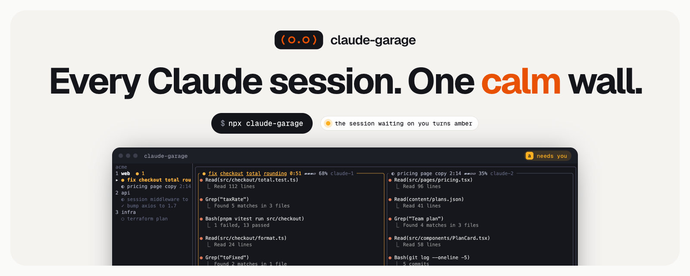
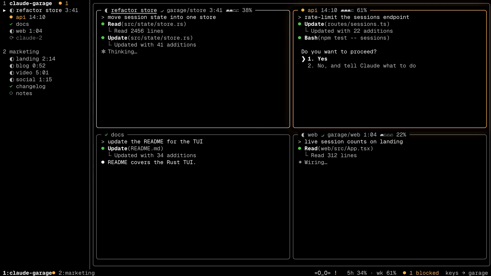
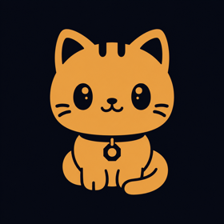

<div align="center">



**Run many Claude Code sessions. See them all in one terminal.**

[](https://www.npmjs.com/package/claude-garage)
[](LICENSE)
[](#privacy)

[Website](https://claude-garage.xyz) · [Docs](https://claude-garage.xyz/docs/) · [Try it in your browser](https://claude-garage.xyz/try/)

If garage saves you some tab-juggling, a ⭐ on this repo helps other Claude Code users find it.



</div>

https://github.com/user-attachments/assets/5c545e4b-508e-4754-9b7a-df73c589e323

## Why

Running several Claude Code sessions means juggling terminal windows.
The hard part isn't the windows. It's knowing **which session is
waiting for you** right now, and not losing sessions when you close a
terminal or reboot.

[herdr](https://github.com/herdrdev/herdr) solves a lot of this and
is a good product. I found it too complex and verbose for what I
needed. So I built something simpler: one wall, one key to jump to
whoever is waiting, and tmux keeping every session alive.

## What it does

- **Shows every session at once.** One full-screen grid per project.
- **Tells you who needs you.** A session waiting for your answer turns
  amber. Press `a` to jump to it, from any project.
- **Keeps sessions alive.** tmux runs them, not garage. Close the
  terminal or reboot, and your sessions come back with their full
  conversation.

It's small: one 17 MB binary (the plugins are inside it), about 6 MB of RAM and ~2% CPU.

## Install

You need:

- macOS or Linux. Windows x64 is a preview: it has a prebuilt binary, but it
  has not been tested on real Windows yet.
- [tmux](https://github.com/tmux/tmux) 3.2 or newer (garage offers to
  install it with `brew`)
- [Claude Code](https://docs.claude.com/en/docs/claude-code) on your `PATH`

Then install garage with whichever you prefer. Each one downloads a
prebuilt binary; nothing is compiled.

```bash
npx claude-garage                                   # needs Node.js 20 or newer
curl --proto '=https' --tlsv1.2 -LsSf \
  https://github.com/adar2378/claude-garage/releases/latest/download/claude-garage-installer.sh | sh
```

On Windows (preview), use the PowerShell installer from the same release page
(`claude-garage-installer.ps1`).

Upgrading from 0.6.x: run `claude-garage` again. It replaces the old
background daemon by itself and leaves your sessions alone.

## First steps

1. Press `w` and add a project folder. You can type, paste or drag the
   path in, or press `Ctrl+O` to pick a folder.
2. Press `n` to start a Claude session in it.
3. Press `Enter` to type into the session. Press `Ctrl+G` to get back to
   garage.
4. Press `?` any time to see all keys.

Press `q` to quit. Your sessions keep running in the background.

## Session states

| Glyph | State | Meaning |
|---|---|---|
| `●` | needs input | Claude is waiting for your answer. Always sorted first. |
| `◐` | working | Claude is running. |
| `✓` | done | Finished since you last looked. |
| `○` | idle | Waiting for your next request. |
| `⟳` | restorable | The session stopped (after a reboot, say). Press `Enter` to bring it back. |

## Keys

**Moving around**

| Key | Action |
|---|---|
| `1`–`9` | switch project |
| `[` / `]` | previous / next session |
| `Tab` | switch view |
| `m` | maximize the focused session |
| `a` | jump to the session waiting longest |
| `A` | list every waiting session |

**Typing into a session**

| Key | Action |
|---|---|
| `Enter` | start typing into the focused session |
| `Ctrl+G` | stop typing, back to garage |
| `t` | open the session in its own terminal window |

**Sessions and projects**

| Key | Action |
|---|---|
| `n` | new session |
| `N` | new session in its own git worktree |
| `x x` | kill the focused session, no history (like 0.6.x) |
| `x X` | close the focused session and keep it in history (a grey row you can restore) |
| `R` | bring back all stopped sessions in this project |
| `d` | move the session into its own view (press again to move it back) |
| `D` | move the session to another view |
| `w` | add a project |
| `X X` | remove the project (sessions keep running) |
| `X K` | remove the project and close its sessions |

Closing a worktree session (`x x` or `x X`) asks whether to merge, discard or keep
its branch.

**Restart and extras**

| Key | Action |
|---|---|
| `r r` | restart the focused session on the latest `claude` |
| `r a` | restart all idle sessions in this project |
| `r d` | restart garage's background service |
| `I` | install hooks (instant status) and the context meter |
| `P` | pick a pit pet |
| `p` | list plugins, turn them on or off |
| `?` | show all keys |
| `q` | quit |

> **Terminal tip:** Ghostty, iTerm2, kitty and WezTerm work best. In
> macOS Terminal.app, `Shift+Enter` acts like `Enter`. Use `Option+Enter`
> for a new line instead.

## Restarting

When Claude Code ships an update, running sessions keep the old version.
To update them:

```bash
claude-garage restart --sessions
```

This restarts every idle session and keeps its conversation. Busy
sessions are skipped. Add `--all` to restart those too.

`claude-garage restart` alone restarts only garage's background service.
Your sessions are not touched.

## Pit pet

An optional pet lives in the bottom bar. It sleeps when all is quiet and
runs to alert you when a session needs you. Press `P` to choose one.

<div align="center">



<b>Arthur</b> &nbsp;&nbsp;&nbsp;&nbsp;&nbsp;&nbsp;&nbsp; <b>Papito</b> &nbsp;&nbsp;&nbsp;&nbsp;&nbsp;&nbsp;&nbsp; <b>Segan</b>
</div>

## Alerts

The built-in `alerts` plugin makes a short chime when a session needs you
(two rising notes) or finishes a turn that ran 20 seconds or more (one soft
note). When no garage window is in view it also shows a desktop banner, such
as "fix needs you" with Claude's own message. Sessions that need you within
two seconds of each other make one chime and one banner.

```bash
claude-garage alerts                    # show the options
claude-garage alerts sound off          # no chime (on | off)
claude-garage alerts needs-input off    # no alert when a session needs you
claude-garage alerts done off           # no alert when a session finishes
claude-garage alerts banners off        # chime only, never a banner
claude-garage alerts test               # play both chimes and show a sample banner
```

Alerts are on by default, also for existing installs: they replace the old
needs-input banner. To turn them off completely, press `p` and switch `alerts`
off; garage will not turn them back on.

## Plugins

garage ships with built-in plugins (the usage bar, the pit pet, alerts and
more). Press `p` to see every plugin, its permissions, and turn it on or off.
Changes apply at once, no restart.

```bash
claude-garage plugin install owner/repo   # add one from GitHub
claude-garage plugin remove <id>          # remove it again
```

Writing your own: see the [plugin docs](docs/plugins/README.md).

## Privacy

Everything stays on your machine.

- garage listens on `127.0.0.1` only.
- No telemetry, no accounts.
- State is one file: `~/.garage/state.json`.

## How it works

```
tmux            runs every session
  └─ daemon     the same binary run as `claude-garage daemon`: starts, lists and watches sessions
       └─ TUI   the Rust terminal wall you look at
```

You can delete garage and your sessions keep running. Reattach any of them
with `tmux attach -t garage/<project>/<label>`.

## Development

```bash
cargo build                                  # the one binary: target/debug/claude-garage
cargo test -p garage-wall --lib --bins       # the TUI
cargo test -p garage-protocol -p garage-host -p garage-daemon -p claude-garage
```

Releases are built by [cargo-dist](https://github.com/axodotdev/cargo-dist)
(`dist-workspace.toml`; `dist plan` shows what a tag would publish). The
first-party plugins are built into the release binary (`--features
bundle-plugins`); a plain `cargo build` finds them in `plugins/` instead.

Note: plain `cargo test` also starts and kills real tmux sessions.

## Roadmap

- Diff review in the TUI
- Adopt an existing tmux session
- Phone notifications

## Support

claude-garage is free, MIT licensed and built by one person. The best way to help:

- **Star the repo.** It is how other Claude Code users find it.
- **Open an issue** when something breaks or feels slow.
- **Share it** with someone who runs more than one Claude session.

## License

[MIT](LICENSE) © Saiful Islam

*Not affiliated with Anthropic. "Claude" and "Claude Code" are Anthropic
trademarks.*
